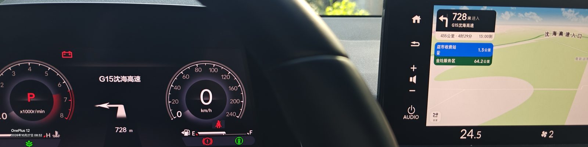
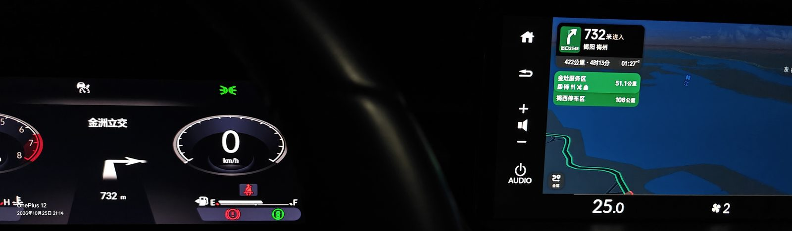
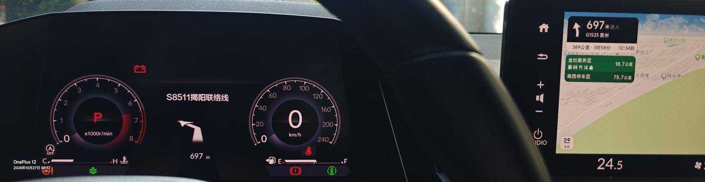
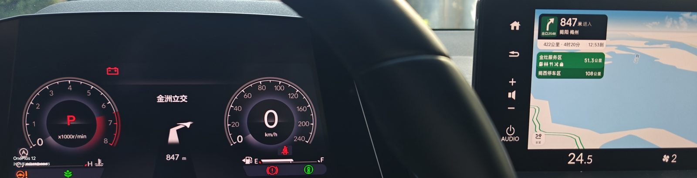
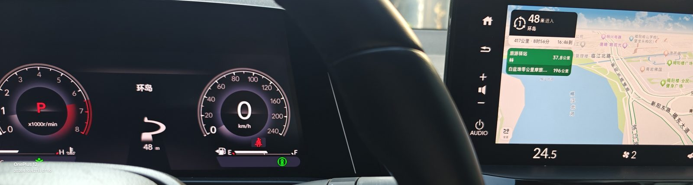
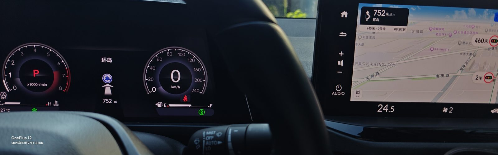
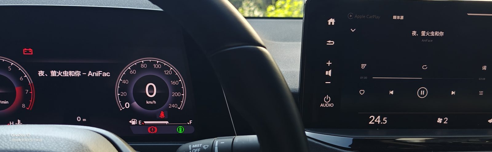
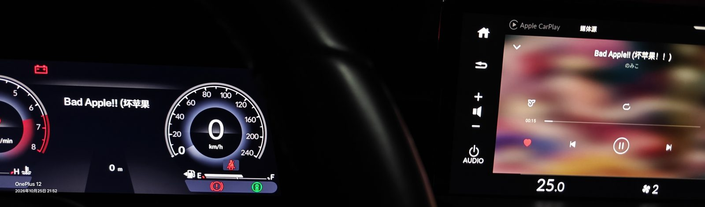
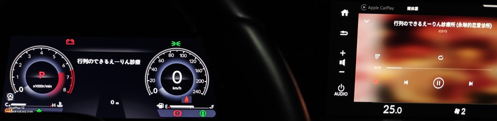

# honda hud diy

把车机玩成砖不要找我，没有人逼着你用该项目，0玩机基础小白请勿听信ai胡说八道，尤其是!!!不要问豆包!!!


项目地址：https://github.com/yuxiuwen64-maker/HondaHUDdiy

- 导航：高德车机版广播 → 仪表显示路名、剩余距离、转向箭头
- 音乐：未导航时显示「歌名 - 歌手」
- 导航期间不显示歌曲；导航结束自动回到歌曲
- 长距离（>1km）也显示路名
- 歌名显示我只测试了网易云音乐车机版，其他音乐软件未测试

## 效果


<table>
<tr>
  <td align="center"><br><sub>左转</sub></td>
  <td align="center"><br><sub>右转</sub></td>
</tr>
<tr>
  <td align="center"><br><sub>左前 45°</sub></td>
  <td align="center"><br><sub>右前 45°</sub></td>
</tr>
<tr>
  <td align="center"><br><sub>进入环岛</sub></td>
  <td align="center"><br><sub>即将进入环岛</sub></td>
</tr>
</table>

未导航时显示歌名：

<table>
<tr>
  <td align="center"></td>
  <td align="center"></td>
  <td align="center"></td>
</tr>
</table>

## 目录

```text
hud/                      HUD 应用源码
modules/hudbridge/        Magisk 模块：priv-app 化 + 开机自启
tools/build-apk.ps1       无 Gradle 构建 APK
tools/build-modules.py    打包 Magisk 模块
docs/PROTOCOL.md          实车验证的 HUD 协议
docs/USAGE.md             安装和使用说明
release/                  已编译 APK / 模块
```

## 构建

```powershell
powershell -ExecutionPolicy Bypass -File tools/build-apk.ps1 `
  -Module hud -Package io.github.hudfree -OutName HUDdiy

python tools/build-modules.py
```

依赖：JDK 17、Android SDK（build-tools 34+、platform 29+）。
`build-apk.ps1` 自动从 `JAVA_HOME`、`ANDROID_SDK_ROOT` 和常见目录查找工具链。

Gradle 8.5+ 也可以：

```bash
gradle :hud:assembleRelease
```

## 安装

1. Magisk 刷入 `release/HUDdiy-Magisk.zip`，重启。
2. 打开「HUDdiy」，开启「开机自动运行」并保存。
3. 授予「通知访问」权限（显示歌名需要）。
4. 高德车机版开始导航即可。

详细步骤见 [docs/USAGE.md](docs/USAGE.md)。

## 协议

绑定 `com.alap.honda30ea.aochr.meterservice` 的 `IMeterServiceManager`：

- 导航：`mode 7` + `1558` + `561036824` + `561033318` + `1284 [type, angle]`
- 音乐：`mode 9` + `1558` + `1538 7`
- 清屏：`mode 12`

完整字段和注意事项见 [docs/PROTOCOL.md](docs/PROTOCOL.md)。

## 安全

> ⚠️ **本机型刷坏了没有无损救砖的办法。**
> 只能把字库（UFS）拆下来用编程器重新刷。
> 如果你不明白自己在做什么，请不要对设备做任何修改。
> 变砖了请不要找我，我也没办法。

- 修改 `/system/product/priv-app` 有风险，刷前务必备份，并确认能接受上面那条后果。
- 仅适用于对应车机/固件；不同车型字段可能不同。
- 本项目按“现状”提供，不对车机损坏或数据丢失负责。

## 许可证

MIT，见 [LICENSE](LICENSE)。
